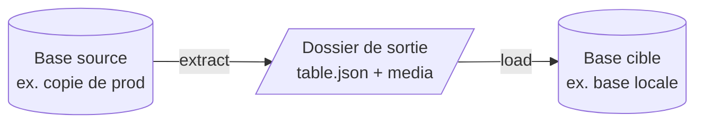
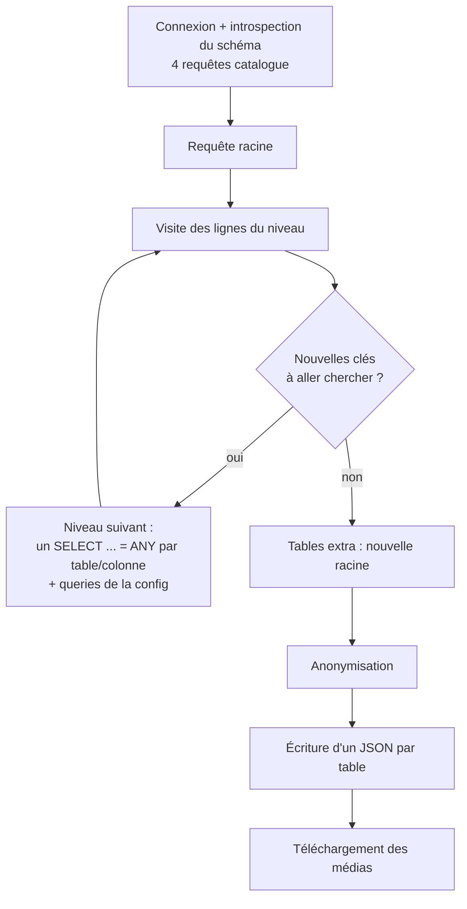
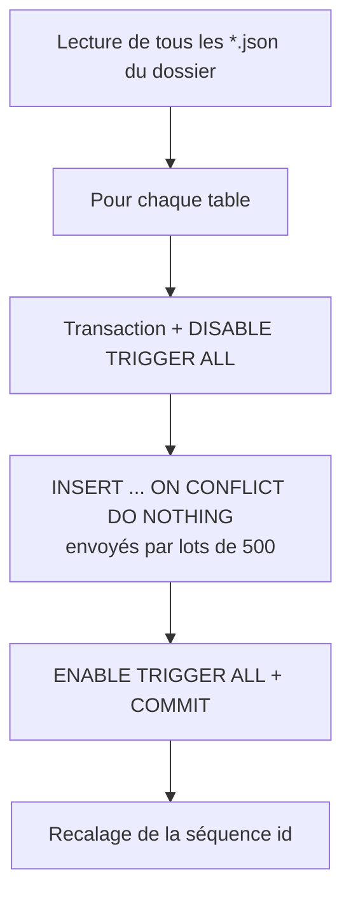

# Fonctionnement de mover

Ce document explique comment mover fonctionne de bout en bout, dans l'état de la branche `feat/perf-fixes`. Il s'adresse à quelqu'un qui doit utiliser mover, écrire sa config ou diagnostiquer un run, sans forcément connaître le code. Les références `fichier:ligne` permettent d'aller plus loin.

## En une phrase

mover part d'une requête SQL (par exemple « l'utilisateur 1 »), suit les clés étrangères pour récupérer tout ce dont ces lignes dépendent, anonymise les colonnes sensibles et écrit un fichier JSON par table. Il sait ensuite recharger ce dossier dans une autre base.

Chez Ulule, c'est ce qui produit les fixtures à partir de la prod (dépôt `ulule-fixtures`).



## 1. Utilisation

```bash
export MOVER_CONF=$PWD/config.json
mkdir -p output   # mover ne crée pas le dossier

# Extraction
mover -dsn "$REMOTE_DSN" -path output -action extract \
      -query "SELECT * FROM auth_user WHERE id = 1"

# Chargement
mover -dsn "$LOCAL_DSN" -path output -action load
```

| Flag | Rôle |
|---|---|
| `-action` | `extract`, `load` ou `describe` (affiche la structure d'une table). Une valeur vide ou inconnue ne fait rien. |
| `-dsn` | Connexion Postgres, obligatoire pour toutes les actions. |
| `-path` | Dossier de sortie (extract) ou d'entrée (load). |
| `-query` | Requête racine de l'extraction. |
| `-table` | Table à décrire, utilisé seulement par `describe`. |
| `-verbose` | Logs détaillés (zap en mode développement). |
| `-version` | Affiche la version. |

La variable `MOVER_CONF` donne le chemin de la config JSON. Si elle est absente ou illisible, mover logue l'erreur et continue sans config, donc sans anonymisation.

**Attention :** mover renvoie toujours le code de sortie 0, même en cas d'erreur. Il faut lire les logs pour savoir si un run a réussi.

## 2. La config

La config décrit ce que mover ne peut pas deviner tout seul à partir du schéma : quelles relations « descendantes » suivre, quelles requêtes ajouter, quelles colonnes anonymiser et quels médias télécharger.

```json
{
  "locale": "fr",
  "schema": [
    {
      "table_name": "auth_user",
      "omit_reference_keys": false,
      "reference_keys": ["project_owner_id_fk"],
      "queries": [
        {"table_name": "payment", "query": "SELECT * FROM payment WHERE user_id = {id}"}
      ],
      "columns": [
        {"name": "email", "fake": "email", "unique": true},
        {"name": "last_name", "fake": "last_name"},
        {"name": "password", "sanitize": true},
        {"name": "username", "replace": "user_{id}"},
        {"name": "avatar", "download": {"http": {"base_url": "https://cdn.example.com/"}}}
      ]
    }
  ],
  "extra": [{"table_name": "country"}]
}
```

| Clé | Effet |
|---|---|
| `locale` | `fr` donne des fausses données françaises. Toute autre valeur garde la locale par défaut du faker. |
| `schema[].table_name` | Table concernée par le bloc. Une table absente de la config est quand même extraite si on l'atteint, simplement sans règle particulière. |
| `reference_keys` | Noms de contraintes FK (`conname`) à suivre « vers le bas », c'est-à-dire du parent vers les enfants, même quand la table n'est pas la racine (voir § 3.3). |
| `omit_reference_keys` | Si `true`, la table racine ne suit pas automatiquement ses enfants. |
| `queries` | Requêtes SQL libres, exécutées une fois **par ligne** de la table. `{col}` est remplacé par la valeur de la colonne. `table_name` indique la table des lignes renvoyées. |
| `columns[].fake` | Remplace la valeur par une fausse : `first_name`, `last_name`, `email`, `street_address`, `phone_number`. |
| `columns[].unique` | Retire au sort jusqu'à obtenir une valeur pas encore utilisée dans cette colonne. |
| `columns[].replace` | Remplace par un gabarit, par exemple `user_{id}`. |
| `columns[].sanitize` | Met la colonne à `NULL`. |
| `columns[].download` | Télécharge le fichier `base_url + valeur` dans `media/`. |
| `extra` | Tables copiées **entièrement** (`SELECT *`), en plus de la requête racine. Utile pour les petites tables de référence. |

Si une colonne a plusieurs règles, l'ordre de priorité est `replace`, puis `fake`, puis `sanitize`.

## 3. Extraction



### 3.1 Introspection du schéma

Au démarrage, mover lit le catalogue Postgres pour connaître les tables, leurs colonnes, leurs clés primaires et leurs clés étrangères (`dialect/postgres/postgres.go:430`). Cela prend 4 requêtes, quel que soit le nombre de tables. Avant cette PR, il en fallait environ 6 par table, soit environ 700 sur ulule.

Pour chaque clé étrangère `enfant.col → parent.id`, mover garde deux vues :
- côté enfant, une **foreign key** : « cette ligne dépend de ce parent » ;
- côté parent, une **reference key** : « ce parent a des enfants dans telle table ».

Seul le schéma `public` est lu, et seulement les tables ordinaires (pas les vues ni les tables partitionnées). Les FK vers un autre schéma sont ignorées.

Cette description du schéma est ensuite fusionnée avec la config (`etl/engine.go:20`).

### 3.2 La requête racine

mover déduit la table de la requête avec une expression régulière sur `SELECT ... FROM <table>` (`etl/util.go:26`). La requête doit donc être simple : pas de jointure, pas de sous-requête, pas de table préfixée par un schéma.

### 3.3 Le parcours en largeur

C'est le cœur de mover (`etl/extractor.go`). Le parcours avance **niveau par niveau**. Pour chaque ligne d'un niveau, mover note ce qu'il faudra aller chercher au niveau suivant :

1. **Les parents (foreign keys)**, toujours. Si une commande pointe vers un utilisateur, l'utilisateur est extrait, sinon la commande ne pourrait pas être rechargée.
2. **Les enfants (reference keys)** :
   - pour une ligne **racine**, tous les enfants sont suivis, sauf si `omit_reference_keys` est vrai ;
   - pour les autres lignes, seulement les relations listées dans `reference_keys` de la config.

   Sans cette règle, partir d'un utilisateur ramènerait toute la base de proche en proche.
3. **Les `queries` de la config**, avec `{col}` remplacé par les valeurs de la ligne.

Au niveau suivant, mover regroupe toutes les valeurs demandées par couple (table, colonne) et les récupère en une seule requête par paquet de 1000 (`dialect/postgres/postgres.go:63`) :

```sql
SELECT * FROM "shop_order" WHERE "user_id" = ANY($1::text[]::integer[])
```

Le double cast permet d'envoyer toutes les valeurs sous forme de texte, quel que soit le type de la colonne. Postgres le replie en constante et utilise l'index normalement. Pour un type de clé qui ne se convertit pas en texte, mover revient à une requête par valeur (`col = $1`).

Deux mécanismes évitent de tourner en rond ou de refaire le même travail :
- une ligne déjà visitée (identifiée par sa table et sa clé primaire) n'est pas revisitée ;
- une valeur déjà demandée pour un couple (table, colonne) n'est pas redemandée.

Le parcours s'arrête quand un niveau n'apporte plus rien de nouveau. Les tables `extra` sont ensuite traitées comme de nouvelles racines, en partageant la mémoire de ce qui a déjà été vu.

À la fin, mover logue le nombre de requêtes et de lignes par table.

**Pourquoi en largeur ?** L'ancienne version suivait les relations en profondeur, avec une requête par ligne et par relation. Sur la prod Ulule, le run était encore en cours au bout de 5 minutes quand il a été annulé. Avec le parcours par niveaux, l'extraction prend environ 80 s et 194 requêtes, pour environ 300 000 utilisateurs et 350 000 lignes de commande.

**Différence de résultat :** quand une racine est d'abord atteinte via une autre racine, l'ancienne version la considérait comme déjà traitée et oubliait d'aller chercher ses enfants. La nouvelle applique les règles de racine à toutes les lignes racines, donc elle peut extraire un peu plus. C'est le comportement voulu.

### 3.4 Anonymisation

L'anonymisation se fait **après** le parcours, juste avant l'écriture (`etl/sanitizer.go`). Les `queries` et le suivi des relations travaillent donc sur les vraies valeurs, seul le fichier écrit est anonymisé. Les lignes sont aussi dédoublonnées par clé primaire à cette étape.

### 3.5 Format de sortie

Un fichier par table, `<path>/<table>.json` :

```json
{
	"table_name": "auth_user",
	"count": 2,
	"data": [
		{"id": 1, "email": "jeanne.martin@example.org", "tags": ["a", "b"]},
		{"id": 2, "email": "paul.durand@example.org", "tags": null}
	]
}
```

Les types Postgres sont convertis en JSON de façon stable (`dialect/postgres/util.go:312`) :
- un tableau donne un tableau JSON, ou `null` s'il est vide ;
- un `numeric` donne un nombre ;
- une plage donne une chaîne du type `"[1,5)"` ;
- une adresse `inet` donne une chaîne.

Le format n'a pas changé avec cette PR : un dossier extrait avec l'ancienne version se recharge avec la nouvelle, et inversement.

### 3.6 Médias

Pour les colonnes avec `download`, mover télécharge `base_url + valeur` dans `<path>/media/` en respectant le chemin de l'URL. Les URL sont dédoublonnées et les téléchargements se font 10 par 10, avec un timeout de 60 s chacun. Un échec, par exemple un 404, est logué mais n'arrête ni les autres téléchargements ni l'extraction.

## 4. Chargement



Le chargement (`etl/loader.go`, `dialect/postgres/postgres.go:139`) :

1. lit tous les fichiers `.json` du dossier, dans l'ordre alphabétique ;
2. pour chaque table, ouvre une transaction et **désactive les triggers**, ce qui désactive aussi les contrôles de clés étrangères. L'ordre des tables n'a donc pas d'importance, mais le rôle Postgres doit avoir les droits pour le faire (en pratique, propriétaire ou superuser) ;
3. insère les lignes avec `ON CONFLICT (pk) DO NOTHING`, envoyées par lots de 500 dans un seul aller-retour réseau. Relancer un load est donc sans risque : les lignes déjà présentes sont ignorées ;
4. réactive les triggers et valide la transaction ;
5. recale la séquence `<table>_id_seq` au-delà du plus grand `id`, pour que les prochains `INSERT` de l'application ne tombent pas sur un identifiant déjà pris.

Les valeurs JSON sont reconverties selon le type de la colonne. Un objet devient du `jsonb`, et un tableau devient un tableau Postgres du bon type (texte, entiers, booléens, flottants, `numeric`, `uuid`, dates). Un type de tableau non géré donne une erreur explicite, avec la colonne et le type en cause.

## 5. Organisation du code

| Paquet | Rôle |
|---|---|
| `cmd/mover` | Lecture des flags et de la config, lancement de l'action. |
| `config` | Structure de la config JSON. |
| `etl` | Partie indépendante de la base : moteur, parcours, anonymisation, écriture, chargement, médias. |
| `dialect` | Interface d'accès à la base et types neutres (table, colonne, FK…). |
| `dialect/postgres` | Seule implémentation : requêtes catalogue, `SelectIn`, `BulkInsert`, conversions de types pgx v5. |

mover utilise une seule connexion Postgres, sans pool. Il n'y a jamais deux requêtes SQL en parallèle, seuls les téléchargements de médias le sont.

## 6. Limites à connaître

- **Schéma `public` uniquement.** Les relations vers un autre schéma sont ignorées.
- **Clé primaire obligatoire et simple.** Une table sans PK fait planter mover. Avec une PK composite, seule la première colonne sert.
- **FK multi-colonnes** : seule la première colonne est prise en compte.
- **Requête racine simple** : `SELECT ... FROM table ...`, sans jointure.
- **Les enfants ne sont suivis automatiquement que depuis la racine.** Plus loin, il faut les déclarer dans `reference_keys`. C'est le principal levier de la config, dans les deux sens : trop peu et il manque des données, trop et l'extraction grossit très vite.
- **`queries` coûte une requête par ligne.** Sur une table de plusieurs milliers de lignes, c'est souvent ce qui domine le temps d'extraction.
- **Grands entiers** : au load, les nombres JSON sont lus en `float64`, donc un `bigint` au-delà de 2^53 perd sa précision.
- **Séquences** : le recalage suppose une colonne `id` et une séquence `<table>_id_seq`. Si elle n'existe pas, le load s'arrête sur cette table.
- **Code de sortie** toujours 0, voir § 1.
